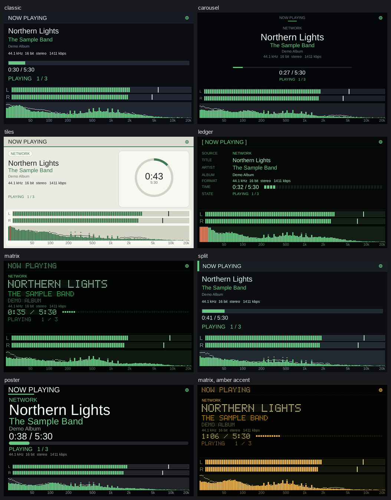
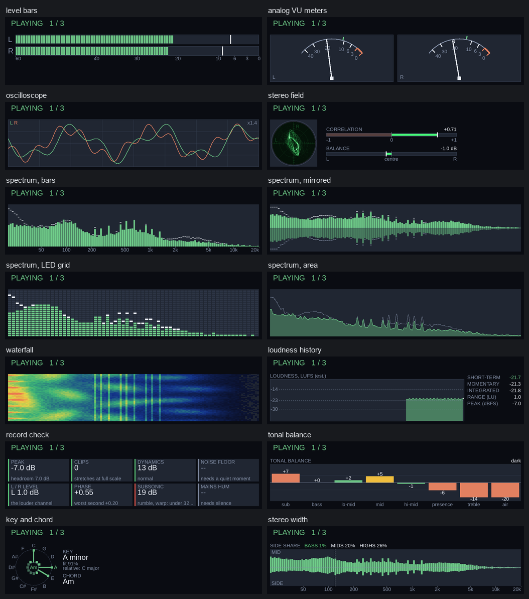
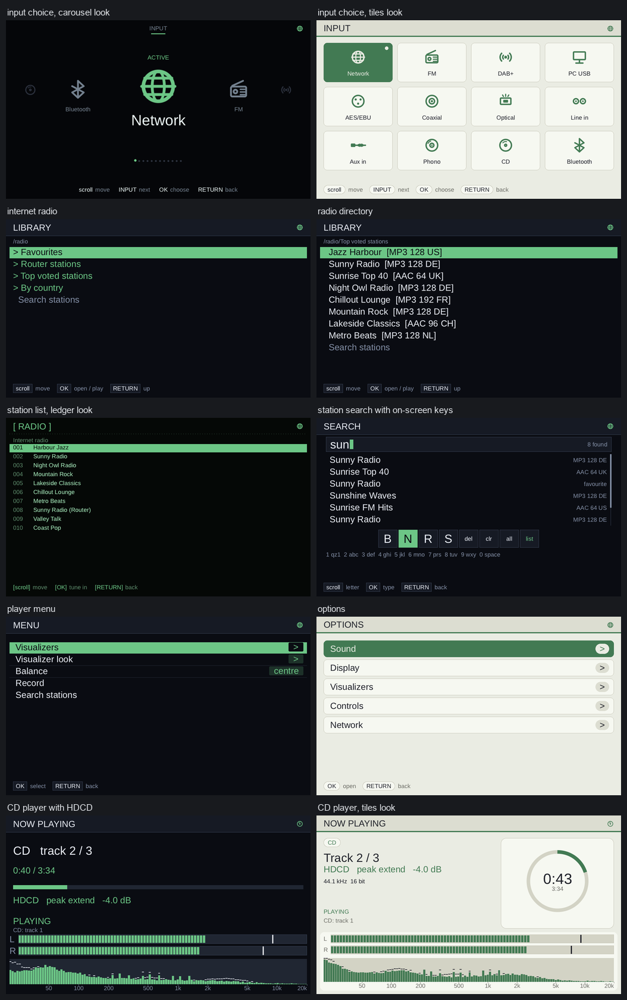
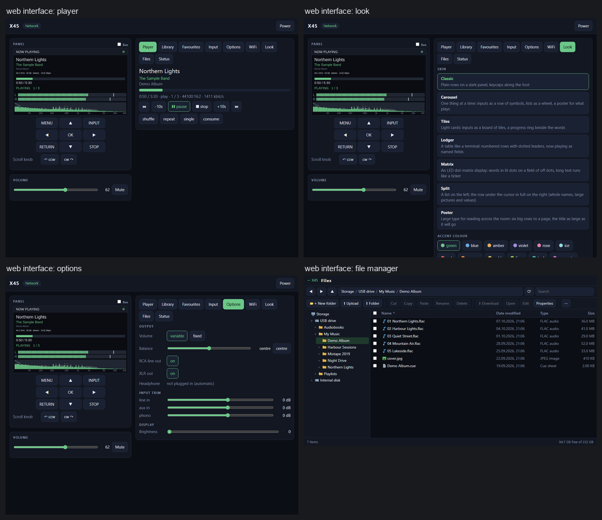

# Cocktail Audio X45 custom firmware

A replacement user interface and audio stack for the Cocktail Audio X45 network player. It is built from source, runs
in place of the original software, adds inputs, looks, visuals and network features, and can be taken off the unit
again.

> **Made with AI.** This software was developed using AI (Claude, by Anthropic). The code, the scripts and this text
> were written by an AI assistant and tested on a real unit. Expect bugs and read what you install.

**Heavily work in progress.** Parts of it are solid, parts are untested, some parts do not work at all (see
[What does not work](#what-does-not-work)). It was developed on one unit and tested on that unit only. Using it is at
your own risk.



## Contents

- [What it is](#what-it-is)
- [Features](#features)
- [Screenshots](#screenshots)
- [What does not work](#what-does-not-work)
- [Quick start](#quick-start)
- [Using it](#using-it)
- [Going back to the original software](#going-back-to-the-original-software)
- [Build options](#build-options)
- [Repository layout](#repository-layout)
- [Dependencies](#dependencies)
- [More documentation](#more-documentation)

## What it is

The X45 runs Linux (kernel 3.14) on an i.MX6 board with a 1024x600 display, a DAC board with an XMOS USB interface,
a DAB+/FM tuner and a CD drive. This project replaces the original player program with its own:

- a panel program (`x45ui`) that draws the screens, reads the keys, the knob and the infrared remote, and talks to
  the hardware
- a web server (`x45web`) with a web interface and a REST API
- MPD as the player behind the network, USB and disk playback
- receivers for AirPlay, UPnP/DLNA, Spotify Connect and Bluetooth
- small helpers for the tuner, the CD drive, recording, Wi-Fi and so on

Everything is written for this one unit. The kernel and the bootloader are not touched. The original software stays
installed on the unit; the new one starts in its place at boot.

You get source code and scripts, not a ready made firmware file. The scripts download the compilers and libraries,
build everything and pack an installable `.pkg`. You can build and install it without knowing how any of it works,
see [Quick start](#quick-start).

## Features

### Inputs and playback

- Twelve inputs: Network, FM, DAB+, PC USB, AES/EBU, Coaxial, Optical, Line in, Aux in, Phono, CD and Bluetooth.
  INPUT opens the choice, and an option switches to the highlighted input after a few seconds without a key press.
- Network input plays through MPD: files on USB sticks and SATA disks, UPnP/DLNA servers on your network, and
  internet radio. Formats are the ones MPD knows (FLAC, MP3, Ogg Vorbis, Opus, WAV, DSD and more).
- High rates: PCM up to 192 kHz and 384 kHz WAV files, DSD64 and DSD128 sent to the DAC as DSD, DSD256 converted to
  352.8 kHz PCM.
- PC USB: the unit shows up as a USB sound card on your computer.
- Volume mode fixed or variable, balance, a trim for each analog input, RCA and XLR outputs switchable.
- Resume: the unit comes back on the input and the radio station it was left on.

### Radio

- DAB+ and FM with station scan, saved stations, signal strength and the DAB slideshow pictures.
- Internet radio: the station list can come from your router (for example the "Internet radio" folder of a
  FRITZ!Box, fetched over UPnP), from your favourites, and from the open radio-browser.info directory.
- Station search on the panel: type to filter, with an on-screen keyboard that the knob or the remote's number keys
  (multi-tap, like old phones) can use.

### Network streaming

- AirPlay (classic AirPlay, from iPhone, iPad and Mac).
- UPnP/DLNA renderer: the unit appears in control apps and plays what they send, at the stream's own rate.
- Spotify Connect (needs a Premium account).
- Bluetooth A2DP sink (SBC), with pairing on the panel. Needs one specific kind of USB Bluetooth stick, see
  [docs/X45-BLUETOOTH.md](docs/X45-BLUETOOTH.md).

### CD, DVD and recording

- Audio CDs from the built-in drive, with the eject button working.
- HDCD discs are decoded (peak extend and gain shown on the panel).
- The sound of video DVDs (PCM and Dolby Digital) plays as chapters.
- CD ripping to FLAC, MP3 320 kbps or MP3 V0 (LAME).
- Recording of any input to FLAC on a connected disk.

### Looks and visuals

- Seven looks for the whole panel: classic, carousel, tiles, ledger, matrix, split and poster. 13 accent colours, 11
  background colours and 7 text colours, plain or smooth text.
- 11 visuals, two on screen at the same time at most: level bars, analog VU meters, oscilloscope, stereo field,
  spectrum (in four styles), waterfall, loudness history, record check, tonal balance, key and chord, stereo width.
- Visuals can be chosen for all inputs together or for each input.
- Screen brightness and a timer that turns the screen off.

### Control

- Panel keys and the knob, with key hints along the foot of every screen.
- The infrared remote of the unit, all buttons mapped (balance, repeat while held, number keys for station search).
- Web interface on port 80: player, library, favourites, input, options, look, Wi-Fi, file manager and status, with
  a live view of the panel and the same keys as buttons.
- A REST API for everything the panel can do, see [docs/X45-API.md](docs/X45-API.md).
- File manager in the browser: browse, upload, download, rename, delete, zip, drag and drop. USB and SATA disks are
  mounted read-only and switched to read-write only while you change something. MPD follows the changes.
- Optional access token for everything that writes.

## Screenshots

These were made with the real panel program running on a PC, with made-up stations, a made-up library and a made-up
signal (and a stand-in for the web server in the web shots). They show the screens as the unit draws them.

The visuals:



Screens: input choice, radio, search, menus, CD:



The web interface:



## What does not work

What is known to be unproven, missing or impossible:

Built, but not proven:

- **Spotify Connect** is built and started with the other services. The last real test with a phone and a Premium
  account is still open.
- **DSD256** is converted to PCM inside MPD. It was verified against a reference conversion on a PC and measured for
  load on the unit, but not listened to through the DAC for long.
- **Video DVD sound and HDCD** were added recently and have had little listening time.
- **Digital inputs** (coaxial, optical, AES/EBU) are implemented, but not every sample rate was tested.
- The unit was tested with one firmware version of the original software. Other versions are untested.

Not working yet:

- **Wi-Fi.** The panel screens, the tools (`wpa_supplicant`, `iw`) and the web tab are in the package. The kernel
  driver for the supported USB Wi-Fi stick has to be built against the unit's own kernel, which the automated build
  does not do, so Wi-Fi does not work with a package you build yourself. Use the Ethernet port.
- **Bluetooth** works only with one kind of USB stick (an AIC8800D80 "WiFi 6" stick that first shows up as a small
  disk). It is an A2DP sink for SBC only. No aptX or LDAC, no Bluetooth LE, and the unit cannot send to a speaker.
- **AirPlay 2** is not built. Classic AirPlay works.
- **Cover art** is not shown on the panel yet.
- The panel has no setting yet to choose between native DSD and PCM.

Will never work:

- **Tidal, Qobuz, Deezer, Roon, Amazon Music and the other streaming services inside the unit.** The original
  firmware used keys and SDKs that belong to the maker of the unit. They are not in this project and will not be.
  Play them from the phone through AirPlay, Bluetooth, Spotify Connect or a UPnP control app instead.
  [docs/X45-STREAMING.md](docs/X45-STREAMING.md) has the details.
- **HDMI output.** The panel is drawn on the built-in display only.
- **SSH.** The package does not enable a remote shell on the unit.
- Anything that needs a change of the kernel or the bootloader.
- Other models. This is for the X45 only.

## Quick start

You need a computer with Linux (Debian or Ubuntu, also inside WSL on Windows), about 10 GB of free disk space, an
internet connection for the first run, and a USB stick formatted as FAT32.

### 1. Build the package

On Linux:

```bash
./make-pkg.sh
```

On Windows, install WSL once (in a PowerShell opened as administrator: `wsl --install -d Ubuntu`, then restart and
finish the Ubuntu first start), then double click `make-pkg.bat`.

That one command does everything:

1. installs the few ordinary programs the build needs (compiler, make, Python, genromfs and so on) with `apt`, if
   they are missing (it asks for your password for that)
2. downloads the cross compiler, the libraries and the program sources, and checks each file against a recorded
   SHA256 sum
3. builds all programs for the unit
4. packs two files into `dist/`: `X45-CA-1.0.0.r9995.pkg` (install) and `X45-REMOVE-1.0.0.r9994.pkg` (take it off
   again), each with a `.sha256` file

The first run downloads about 1 GB and takes 20 minutes to an hour. It can be run again after an error and then
continues where it stopped. If you only want to prepare the tools, `./setup.sh` does steps 1 and 2.

### 2. Put it on a USB stick

```bash
./install.sh
```

On Windows run `install.bat`. Both list the drives, ask which one is your stick, copy the package as `firmware.pkg`
and compare the copy with the original. Nothing is written anywhere else.

### 3. Install it on the unit

1. Eject the stick and plug it into the USB port of the unit.
2. Open the unit's normal firmware update (Setup menu, firmware update), choose `firmware.pkg` on the stick and
   confirm.
3. Wait until the unit restarts by itself. The first start takes a little longer.

If the unit does not offer a firmware update, plug the stick in and hold the MENU key while you switch the power on.
The updater then looks for `firmware.pkg` on the stick.

The package only adds files. It does not replace the original software, the kernel or any system file. The installer
checks its own files first, and it stops without changes if the unit does not look like an X45.

## Using it

**Panel.** The keys and the knob do what the hints at the foot of each screen say. The main ones:

| Key | What it does |
|---|---|
| MENU | switch between the screens (player, library, radio, CD, ...) |
| hold MENU | open the options: Sound, Display, Visualizers, Controls |
| RETURN | back, and on the player the menu with visualizers, balance, record and search |
| INPUT | choose the input |
| OK | play and pause, open, confirm |
| knob | scroll, and skip tracks on the player |
| volume knob | volume |
| STOP | stop; hold it to delete the playing file or entry (only on a disk that can be written) |

**Web interface.** Open `http://` and the unit's address in a browser. The address is on the Status screen of the
panel and in your router's list of devices. All tabs work from a phone too.

**Remote.** The original infrared remote works with all its buttons. The table is in
[docs/X45-REMOTE.md](docs/X45-REMOTE.md).

**Settings.** The options on the panel and the Look tab of the web interface write to
`/home/root/x45new/etc/x45ui.conf` on the unit. [conf/x45ui.conf.example](conf/x45ui.conf.example) lists every key.
[docs/X45-PANEL-OPTIONS.md](docs/X45-PANEL-OPTIONS.md) explains every option.

**Music.** Plug in a USB stick or a SATA disk. Its folders show up in the library. Put music on it with the file
manager of the web interface or on a computer. The station list of the router and the open directory show up under
Radio.

**Recording and ripping.** The Record row of the player menu (RETURN) and the REC key of the remote ask first, then
record the current input to FLAC. On the CD input the same thing rips the disc, in the format set under Options >
Controls > CD rip format (FLAC, MP3 320 or MP3 V0). Holding STOP ends a recording.

## Going back to the original software

The original software is still on the unit, so going back only means taking the new software away:

1. Run `./make-pkg.sh` once if you do not have the files yet, then `./install.sh --remove` (Windows: `remove.bat`).
   It copies the removal package to a stick as `firmware.pkg`.
2. Install it on the unit the same way as the first package.

The removal package deletes the program tree and the start hook it added and starts nothing else. Your settings in
`/home/root/x45new/etc` stay, so installing again picks them up.

Two safety nets are built in:

- If the new software fails to start three times in a row, the unit turns it off by itself and starts the original
  software.
- If the unit does not show the firmware update, hold MENU while switching on with a stick that has the original
  firmware package (from the maker's site) named `firmware.pkg`.

You can test the installers without a unit: `scripts/test-payload.sh` runs them against a made-up file system on your
computer and checks a fresh install, a second install, a damaged package, a wrong file system and the removal.

## Build options

```bash
./make-pkg.sh                          # everything, then the packages
./setup.sh                             # only the programs, downloads and compilers
./build.sh                             # only the build
./build.sh deps panel mpd              # only some steps (deps panel mpd airplay upnp spotify wifi bluetooth stage)
./build.sh clean                       # remove the build directory, keep the downloads
X45_SKIP="spotify bluetooth" ./make-pkg.sh   # leave out optional parts (airplay spotify upnp wifi bluetooth)
```

Environment variables: `X45_BUILD` (where the build goes, default `.build`, or `~/x45-build` on a Windows drive under
WSL), `X45_DL` (the download cache, can be shared between checkouts), `X45_JOBS` (parallel compile jobs),
`X45_REV` (the revision number in the package name).

Leaving out Spotify (the Rust compiler is the biggest download) saves the most time and space.

## Repository layout

| Folder or file | Content |
|---|---|
| `src/x45ui/` | the panel program: screens (`ext/`), looks (`skins/`), visuals (`vis/`) |
| `src/x45web/` | web server, REST API, file manager |
| `src/libx45/` | shared code: hardware access, clock handling, MPD client, drawing, stations, Wi-Fi |
| `src/x45cd/`, `src/x45tuner/`, `src/tools/` | CD player and ripper, DAB+/FM tuner, small tools |
| `deploy/` | what is copied to the unit as it is: start scripts, web page, icons |
| `conf/` | example configuration files |
| `patches/` | small changes to MPD, BTstack, liba52 and upmpdcli |
| `scripts/` | download, build, pack and test scripts |
| `docs/` | documentation |
| `setup.sh`, `build.sh`, `make-pkg.sh` | the build, in the order of the quick start |
| `install.sh`, `install.bat`, `remove.bat` | put a package on a USB stick |

## Dependencies

Nothing below is stored in this repository. `scripts/fetch.py` downloads it from the original source and checks it
against the SHA256 sums in `scripts/sources.txt`. Exact versions, the parts that are only used to build, and notes on
the terms of each part are in [docs/THIRD-PARTY.md](docs/THIRD-PARTY.md).

**On the computer that builds** (`setup.sh` installs the first group with `apt`):

| What | Used for |
|---|---|
| build-essential (gcc, make), python3, perl, patch, bzip2, xz-utils, tar, gawk, sed, ca-certificates | build and download |
| genromfs | packs the `.pkg` (a romfs image) |
| WSL with Ubuntu | only on Windows |

**Downloaded for the build:**

| What | Version | Used for |
|---|---|---|
| Bootlin armv7-eabihf musl toolchain | stable-2021.11-1 | the ARM cross compiler |
| Meson, Ninja, pkgconf | 1.4.1, 1.12.1, 2.2.0 | build tools |
| m4, autoconf, automake, libtool | 1.4.19, 2.71, 1.16.5, 2.4.7 | build tools for libraries |
| Rust and its armv7 musl standard library | 1.99.0 | builds librespot |

**Programs and libraries on the unit** (all linked statically):

| What | Version | Used for |
|---|---|---|
| MPD | 0.23.15 | player daemon (with three patches of this project) |
| Boost, fmt | 1.83.0, 10.1.1 | needed by MPD |
| alsa-lib | 1.2.11 | sound output |
| libogg, libvorbis, Opus, opusfile | 1.3.5, 1.3.7, 1.4, 0.12 | Ogg and Opus |
| FLAC | 1.4.3 | FLAC |
| libsndfile | 1.2.2 | other audio formats |
| libmad, libid3tag | 0.15.1b | MP3 and tags |
| LAME | 3.100 | MP3 encoding when ripping |
| zlib, Mbed TLS, curl, expat | 1.3.1, 3.6.2, 8.10.1, 2.6.3 | network and XML |
| CA certificate bundle | from curl.se | HTTPS |
| stb_image, stb_truetype | pinned commits | pictures and fonts in the panel |
| Liberation Sans | 2.1.5 | font of the panel |
| liba52 (a52dec) | 0.7.4 | Dolby Digital sound of video DVDs |
| FFmpeg's `af_hdcd` filter | ported to C | HDCD decoder |
| shairport-sync, libconfig, popt, ALAC | 4.3.4, 1.7.3, 1.19, 5d8c5db | AirPlay |
| upmpdcli, libupnpp, libnpupnp, libmicrohttpd, jsoncpp, libmpdclient | 1.8.18, 0.26.8, 6.1.3, 1.0.1, 1.9.5, 2.22 | UPnP/DLNA renderer |
| librespot and its Rust crates | 0.8.0 | Spotify Connect |
| libnl, iw, wpa_supplicant | 3.9.0, 6.9, 2.11 | Wi-Fi tools |
| BTstack, libusb | e385539, 1.0.27 | Bluetooth |
| AIC8800D80 firmware files (radxa-pkg/aic8800) | pinned commit | Bluetooth stick |

Optional parts can be left out with `X45_SKIP` (airplay, spotify, upnp, wifi, bluetooth).

## More documentation

| File | Content |
|---|---|
| [docs/X45-PANEL-OPTIONS.md](docs/X45-PANEL-OPTIONS.md) | the options and controls of the panel |
| [docs/X45-SKINS.md](docs/X45-SKINS.md) | the looks and how to write one |
| [docs/X45-VISUALS.md](docs/X45-VISUALS.md) | the visuals and how to write one |
| [docs/X45-REMOTE.md](docs/X45-REMOTE.md) | the infrared remote |
| [docs/X45-API.md](docs/X45-API.md) | the REST API |
| [docs/X45-FILES.md](docs/X45-FILES.md) | the file manager |
| [docs/X45-TUNER.md](docs/X45-TUNER.md) | the DAB+/FM tuner |
| [docs/X45-STREAMING.md](docs/X45-STREAMING.md) | streaming services: what works and what cannot |
| [docs/X45-BLUETOOTH.md](docs/X45-BLUETOOTH.md) | the Bluetooth stack and the stick |
| [docs/X45-DSD.md](docs/X45-DSD.md) | DSD and high rate PCM |
| [docs/X45-HDCD.md](docs/X45-HDCD.md) | the HDCD decoder |
| [docs/X45-DVD.md](docs/X45-DVD.md) | DVD sound |
| [docs/THIRD-PARTY.md](docs/THIRD-PARTY.md) | third party software, versions and terms |

This project is not affiliated with the maker of the unit and is not endorsed by anyone named here. Product names
belong to their owners and are used only to say what the software works with.
